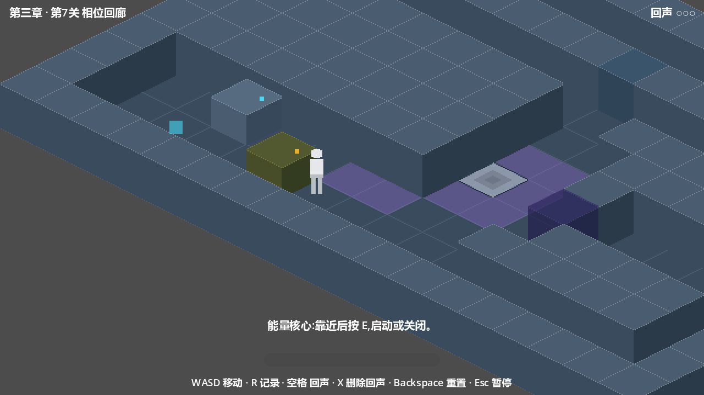

<div align="center">

# Echoes of Yesterday
### 昨日回声

*Record your past. Cooperate with it. Escape a facility where time itself has gone wrong.*

**English** · [简体中文](README.zh-CN.md)


**[⬇ Download the latest build](https://github.com/Balsam1213/echoes-of-yesterday/releases/latest)**

</div>

---

## What is this?

**Echoes of Yesterday** is a 2.5D isometric pixel-art puzzle game built with Godot 4 and GDScript. You are trapped in an underground research facility where time has started to misbehave. Your only tool is a portable time recorder: **record a stretch of your own movement, and a translucent echo of your past self will replay it exactly** — holding down switches, pressing buttons, opening doors — while you are free to act in the present.

Every puzzle is built from one question: **what were you doing, and when?** Your echo does not think, improvise, or wait for you. It walks the route you walked, at the pace you walked it, forever — so the real puzzle is composing **four timelines at once**: up to three echoes of your past, and the you of right now.

The full campaign covers three chapters and eight levels, from your very first echo to the heart of the core laboratory, where the time anomaly peaks — and where you may discover you have been here before.



## The core loop

1. **Observe** the room and its mechanisms.
2. **Record** (R) a stretch of movement — recording may only *start* inside the level's recording zone, and ends by returning you to your starting position.
3. **Replay** (Space) — an echo spawns at the recording start and repeats your route frame by frame, then *parks* at its final position, still operating whatever it stands on.
4. **Cooperate** — a switch held by your echo stays held while you walk through the door it opened.
5. Only the most recent recording is kept; fire an echo before recording the next route. **X** deletes your newest echo when plans change, **Backspace** resets the whole room.

Replays are driven by a fixed 60 Hz physics tick, so they are deterministic regardless of display frame rate — an echo is a *schedule*, and you can measure it using the faint trajectory line every echo leaves behind.

## Features

- **Deterministic time replay** — echoes re-run recorded movement *and* recorded interactions (E-presses) on the same frames they happened, at 60 Hz physics timing.
- **Up to three echoes at once**, capped per level (1 → 2 → 3) and all spawning from the recording zone — echoes are a shared resource you have to schedule.
- **12 mechanisms** across the campaign: pressure switches, security doors, time locks, interference fields, pulse pads, energy cores, toggle barriers, sequence gates, recording zones, phase gates, paradox fields — plus per-level aggregation logic (co-presence windows, sequence validation, multi-condition final doors).
- **Escalating puzzle grammar**: route planning → launch timing → multi-echo scheduling → and finally *presence scheduling*: in a paradox field, you and your past cannot share the same space — someone has to wait.
- **Visible, teachable failure**: echoes shatter in interference fields, dissolve in paradox fields, and get rejected by sequence gates — every rule is taught by letting you safely break it. No hidden passwords, no pixel hunts.
- **Trajectory afterglow** — every replay leaves a faint trace you can measure against.
- **Progress-friendly level select** — replay anything you have completed, or jump straight back to your furthest reached level; progress is autosaved.
- **Hand-authored isometric rooms** (diamond-down 64×32 grid) with Y-sorted cubes, camera limits, and a 640×360 pixel-art presentation.

## The three chapters

| Chapter | Levels | New mechanics | Puzzle focus |
| --- | --- | --- | --- |
| **I · Awakening** (苏醒) | 1–3 | Recording/echoes, pressure switch, security door, time lock | The core loop; holding switches with echoes; 10-second time-lock sprints |
| **II · Time Anomaly** (时间异常) | 4–6 | Interference fields, pulse pads, energy cores, toggle barriers, sequence gates | Route planning around hazards; instant-trigger pads; recorded interactions; order-sensitive mechanisms; multi-echo scheduling |
| **III · Echoes of Yesterday** (昨日回声) | 7–8 | Phase gates, paradox fields, core-driven phase locks, dual countdown finale | Presence scheduling — you and your past cannot share the same space; firing echoes from the *other* side; a 10-second blackout × 10-second time-lock final sprint |

Level names: 1 First Echo · 2 Double Action · 3 Different Paths · 4 Time Interference · 5 The Repeated Experiment · 6 The Runaway Zone · 7 The Phase Corridor · 8 The Echo of Yesterday.

## Controls

| Key | Action |
| --- | --- |
| `W A S D` | Move (8 directions) |
| `R` | Start / stop recording (30 s max, start inside the recording zone) |
| `Space` | Replay the latest recording as an echo |
| `X` | Delete the newest echo |
| `E` | Interact (energy cores and similar) |
| `Backspace` | Reset the level (echoes, mechanisms, position) |
| `Esc` | Pause menu (resume / restart / level select / quit) |

## Download & play

1. Grab `EchoesOfYesterday_Chapter3_v0.1.zip` from the [**latest release**](https://github.com/Balsam1213/echoes-of-yesterday/releases/latest).
2. Unzip and run `EchoesOfYesterday.exe` (Windows 10/11 64-bit, nothing to install).
3. If Windows SmartScreen warns about an unrecognized app: this build is not code-signed — click **More info → Run anyway**. Full details are in `操作说明.txt` inside the zip (Chinese, with per-level hints).

## Building from source

1. Install [Godot 4.7.2](https://godotengine.org/download) (developed and tested on 4.7.2 stable).
2. Open `EchoesOfYesterday/project.godot` in the editor and press **F5**.
3. CLI equivalents used by this repo:

```bash
# run a level headless smoke / regression suite
godot --path EchoesOfYesterday -s tools/regression_m7.gd
godot --path EchoesOfYesterday -s tools/smoke_level08.gd

# export the Windows build
godot --headless --path EchoesOfYesterday --export-release "Windows Desktop" "../build/EchoesOfYesterday.exe"
```

## Development

The game is developed AI-pair style against a self-contained documentation system:

```
Echoes of Yesterday/
├── docs/            # 00–19: requirements, tech design, per-level designs, test baseline
├── logs/            # devlog / changelog / issues (append-only history)
├── EchoesOfYesterday/
│   ├── scenes/      # levels, mechanisms, player, echo, UI
│   ├── scripts/     # player / echo / recording / interaction / level / save / ui / core
│   ├── tools/       # build_level_*.gd, regression_*.gd, smoke_*.gd, seal audit, probes
│   └── assets/      # placeholder art & audio
└── .agents/skills/echoes-of-yesterday-dev/   # project skill: contracts, isometric rules, hard rules, workflows
```

- **docs/00–19** are the single source of truth (requirements → tech design → per-level design → test baseline), with a deviation registry for every decision that broke the original plan.
- **Every change to core mechanics must pass the automated suites**: three regression packs (record/replay invariants; chapter-2 mechanisms; chapter-3 mechanisms incl. seal audit) plus per-level smoke tests that play each level end-to-end and assert level-to-level advancement. Logs must stay free of `SCRIPT ERROR`.
- **`.agents/skills/echoes-of-yesterday-dev/`** encodes the project's hard rules (60 Hz determinism, isometric layout law, footprint collisions, mechanism contracts, seal audits) so new work reuses the existing systems instead of reinventing them.
- Day-to-day workflow lives in `docs/07`; the changelog in `logs/changelog.md` tracks every user-perceivable change.

## Roadmap

- [ ] Final art & audio pass (current visuals are functional placeholder cubes)
- [ ] Gamepad support
- [ ] Code signing (removes the SmartScreen warning; options under evaluation)
- [ ] Post-demo chapters / mechanics

## License

© 2026 Balsam1213. All rights reserved.
