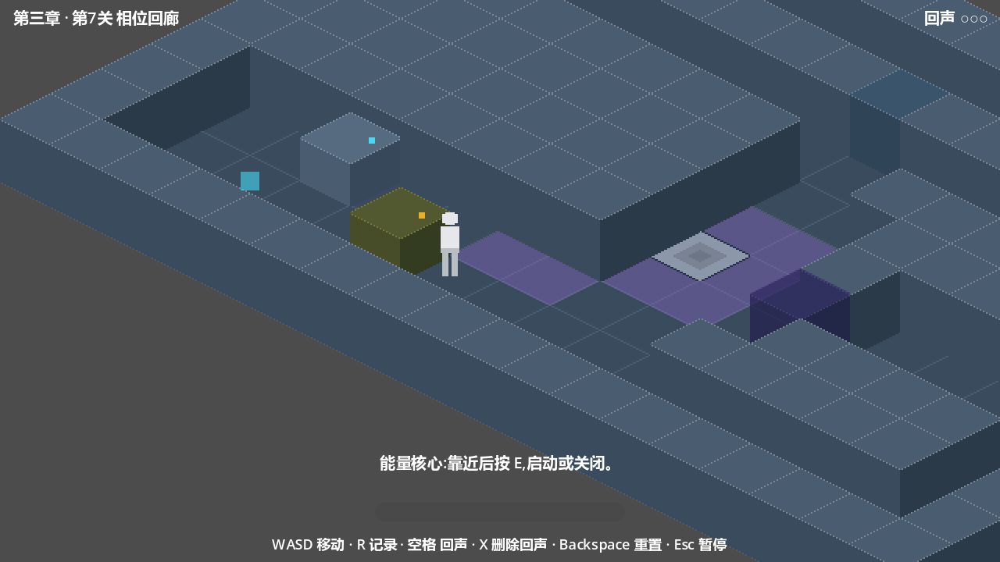

<div align="center">

# 昨日回声
### Echoes of Yesterday

*记录过去的自己,并与它协作——逃出一座时间出了错的地下研究所。*

[English](README.md) · **简体中文**


**[⬇ 下载最新版本](https://github.com/Balsam1213/echoes-of-yesterday/releases/latest)**

</div>

---

## 这是什么?

**《昨日回声》** 是一款用 Godot 4 + GDScript 开发的 2.5D 等距像素风解谜游戏。你被困在一座时间开始出错的地下研究所里,唯一的工具是一台便携时间记录仪:**录下自己的一段行动,一个半透明的"过去的你"就会原样重演**——替你踩住开关、按下按钮、打开大门——而你可以自由地行动于"现在"。

每一个谜题都建立在同一个问题上:**你在做什么,以及在什么时候?** 回声不会思考、不会变通、也不会等你。它只会沿着你走过的路、以你走过的节奏,永远走下去——于是真正的谜题是同时编排**四条时间线**:最多三个过去的你,加上现在这个你。

完整战役包含三章共八个关卡:从你的第一次回声,一路走到核心实验室的最深处——时间异常在这里达到顶峰,而你可能也会发现,自己早已来过这里。



## 核心循环

1. **观察**房间与机关。
2. **记录**(R)一段移动——记录只能**从关卡的初始记录区开始**,结束时你会自动回到起录位置。
3. **回放**(空格)——回声从起录点出现,逐帧重演你的路线,然后**停留在末帧**,继续压着它脚下的机关。
4. **协作**——回声踩住的开关持续生效,你从它打开的门里走过去。
5. 只保留最近一条记录:录新路线前,记得先发射上一条回声。计划有变时按 **X** 删除最新回声,**Backspace** 整间重置。

回放由固定 60Hz 物理帧驱动,与显示帧率无关、完全可复现——回声是一份**时刻表**,而每条回声留下的淡色轨迹线,就是供你丈量这份时刻表的工具。

## 特性

- **确定性的时间重演**:回声按原帧重演移动 *与* 交互事件(E 键按压),60Hz 物理时序,与帧率解耦;
- **最多三条回声同场**,逐关开放上限(1 → 2 → 3),且一律从记录区出发——回声是需要调度的共享资源;
- **12 种机关**贯穿战役:压力开关、安全门、时间锁、干扰场、脉冲板、能量核心、联动屏障、序列门、记录区、相位门、悖论区——外加关卡层聚合逻辑(同振窗、顺序校验、多条件终局门);
- **谜题语法逐章升级**:路线规划 → 发射时机 → 多回声调度 → 最终的**在场调度**:在悖论区里,你与你的过去不能同场——总得有人等一等;
- **可见的、可教学的失败**:回声在干扰场里碎裂、在悖论区里消散、在序列门前被拒——每条规则都通过"让你安全地搞砸一次"来教会。没有隐藏密码,没有像素级寻物;
- **轨迹残影**:每次回放留下淡色轨迹,可据此测量回声的到达时刻;
- **不丢进度的关卡选择**:已通关关卡与你玩到的最新一关都可随时进入;进度自动存档;
- **手工搭建的等距房间**(菱形下落 64×32 网格)、Y-sort 立方体、相机卷动、640×360 像素风呈现。

## 三个章节

| 章节 | 关卡 | 新增机关 | 谜题重心 |
| --- | --- | --- | --- |
| **第一章 · 苏醒** | 1—3 | 记录/回声、压力开关、安全门、时间锁 | 核心循环;用回声压住开关;10 秒时间锁冲刺 |
| **第二章 · 时间异常** | 4—6 | 干扰场、脉冲板、能量核心、联动屏障、序列门 | 绕行危险区的路线规划;瞬踩与发射时机;交互事件随回声重演;只认顺序的机关;多回声调度 |
| **第三章 · 昨日回声** | 7—8 | 相位门、悖论区、核心驱动的相位锁、双倒计时终局 | **在场调度**——你与你的过去不能同场;从门的另一侧发射回声;断电 10s 窗 × 时间锁 10s 窗的终局冲刺 |

关卡名:1 第一次回声 · 2 双重行动 · 3 不同的路径 · 4 时间干扰 · 5 重复的实验 · 6 失控区域 · 7 相位回廊 · 8 昨日回声。

## 操作

| 按键 | 动作 |
| --- | --- |
| `W A S D` | 移动(八方向) |
| `R` | 开始 / 结束记录(上限 30 秒,须在记录区内起录) |
| `空格` | 将最近一条记录回放为回声 |
| `X` | 删除最新的回声 |
| `E` | 交互(能量核心等) |
| `Backspace` | 重置本关(回声、机关、位置) |
| `Esc` | 暂停菜单(继续 / 重开本关 / 关卡选择 / 退出) |

## 下载与运行

1. 从 [**最新 Release**](https://github.com/Balsam1213/echoes-of-yesterday/releases/latest) 下载 `EchoesOfYesterday_Chapter3_v0.1.zip`。
2. 解压后双击 `EchoesOfYesterday.exe`(Windows 10/11 64 位,无需安装)。
3. 若 Windows SmartScreen 提示"无法识别的应用":本构建未购买代码签名证书——点击**更多信息 → 仍要运行**。zip 内附完整 `操作说明.txt`(含轻度剧透的分关提示)。

## 从源码运行

1. 安装 [Godot 4.7.2](https://godotengine.org/download)(开发与测试均在 4.7.2 stable 完成)。
2. 用编辑器打开 `EchoesOfYesterday/project.godot`,按 **F5** 运行。
3. 本仓库使用的命令行等价操作:

```bash
# 无头回归 / 关卡冒烟
godot --path EchoesOfYesterday -s tools/regression_m7.gd
godot --path EchoesOfYesterday -s tools/smoke_level08.gd

# 导出 Windows 构建包
godot --headless --path EchoesOfYesterday --export-release "Windows Desktop" "../build/EchoesOfYesterday.exe"
```

## 开发

本项目以「AI 结对 + 自足文档体系」的方式开发:

```
Echoes of Yesterday/
├── docs/            # 00–19:需求、技术方案、逐关设计、测试基线(唯一需求依据)
├── logs/            # devlog / changelog / issues(只追加的历史)
├── EchoesOfYesterday/
│   ├── scenes/      # levels、mechanisms、player、echo、ui
│   ├── scripts/     # player / echo / recording / interaction / level / save / ui / core
│   ├── tools/       # build_level_*.gd、regression_*.gd、smoke_*.gd、密封审计、探针
│   └── assets/      # 占位美术与音效
└── .agents/skills/echoes-of-yesterday-dev/   # 项目专属技能:契约、等距法则、硬规则、工作流
```

- **docs/00–19 是唯一有效需求依据**(需求 → 技术方案 → 逐关设计 → 测试基线),偏离原方案的重大决策全部登记于偏离登记表;
- **核心机制的任何改动必须通过自动化套件**:三个回归包(记录/回放不变量;第二章机关;第三章机关含密封审计)+ 逐关冒烟(完整通关并断言关卡推进);日志必须保持无 `SCRIPT ERROR`;
- **`.agents/skills/echoes-of-yesterday-dev/`** 固化了项目硬规则(60Hz 确定性、等距法则、脚印碰撞、机关契约、密封审计),让新工作复用既有系统而非重造轮子;
- 日常工作流见 `docs/07`;用户可感知的变化记录于 `logs/changelog.md`。

## 路线图

- [ ] 正式美术与音频(当前为功能性占位素材)
- [ ] 手柄支持
- [ ] 代码签名(消除 SmartScreen 提示;方案评估中)
- [ ] Demo 之后的章节与机关

## 许可

© 2026 Balsam1213. All rights reserved.
